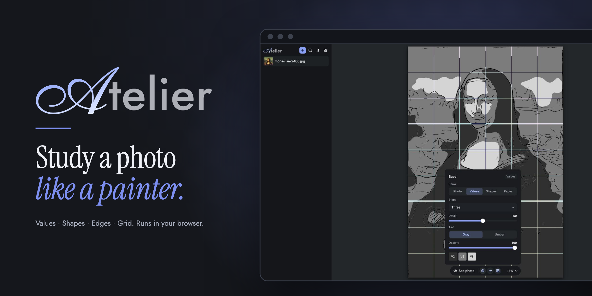

<div align="center">


# Atelier

**Study a photo like a painter.**<br>
Flat values, paint shapes, clean lines and a grid over your own photo. It runs in your browser, and your photos never leave it.

[](https://atelier.stevanpavlovic.com)
[](crates/atelier-core)
[](crates/atelier-wasm)
[](app/web)
[](#-privacy)
[](AGENTS.md)
[](#-license)

[Try it](#-try-it) · [What you get](#-what-you-get) · [Every day](#-every-day) · [How it works](#-how-it-works) · [Docs](docs/README.md)

<br>



</div>

## ⚡ Try it

Open **https://atelier.stevanpavlovic.com** on a desktop or a laptop, then drop a photo on the page.
Nothing to install, no account.

Run it on your own machine with [mise](https://mise.jdx.dev). It installs Rust, Node, pnpm and the wasm tools.

```bash
mise install
mise run web:dev
```

Then open http://localhost:5173/. More commands: [CONTRIBUTING.md](CONTRIBUTING.md).

## ✨ What you get

| | |
|---|---|
| 🌗 **Values** | The photo in 2 to 5 flat tones, each named as a Munsell value (V1 dark to V9 light). Six presets, from Notan to Families. Press a tone to see it big, to match a paint chip. |
| 🎨 **Shapes** | The photo cut into the shapes you paint, in the order you paint them: shadows, halftones, lights, accents. Each step lists the piles of paint to mix. |
| ✍️ **Pencil** | The photo as a smooth gray picture in the tones of your graphite pencils (4H to 9B, drop any you do not own), a little simplified so it is easy to draw. Tone, Drawing (with grain and hatching) or flat Zones. The legend says how much of each pencil to use. Only the Grid works over it. |
| ✏️ **Edges** | A line drawing traced from the photo: Lines, Transfer or Masses. Big forms get heavy lines, detail gets light ones. |
| 📐 **Grid** | Thirds, a square grid or both, to copy proportions. Contrast lines stay visible on any part of the photo. |
| 📏 **Real size** | Lock the zoom to a width in cm and hold a brush or a canvas next to the screen. |
| 🗂️ **Your photo list** | Every photo you add stays in the list, with its own zoom. Search, sort, list or tiles. |
| 🔒 **Private by design** | The photo is decoded and drawn on your device. No upload, no analytics, no account. |
| 🦀 **One Rust core** | All pixel work is Rust compiled to wasm. The same photo gives the same bytes every time. |

## 🧭 Every day

The bottom bar holds everything.

| Control | What it does |
|---|---|
| **See photo** | Hold it, or hold `Space`, to see the bare photo. |
| **Base** | Photo, Values, Shapes, Paper (only the lines on white) or Pencil. |
| **Edges**, **Grid** | Turn a see-through layer on and set it. One card opens at a time; `Esc` closes it. |
| **Zoom** | Fit, 100%, 200% or Real size (cm). A double click toggles Fit and 100%. |
| Arrow keys | Move the photo 10 px, or 100 px with `Shift`. |
| `[` | Hide or show the photo list. |

Every control, one by one: [docs/web-app.md](docs/web-app.md).

## 🔒 Privacy

Nothing leaves your device. Photos are decoded and drawn in your browser and kept in its own
storage (IndexedDB). The page loads one wasm file and sends no photo and no analytics anywhere.
See [SECURITY.md](SECURITY.md).

## 🧱 How it works

| Part | Job |
|---|---|
| [`crates/atelier-core`](crates/atelier-core) | All pixel work in Rust: values, shapes, the edge map and the grid. Deterministic. |
| [`crates/atelier-wasm`](crates/atelier-wasm) | The core compiled to wasm for the browser. |
| [`app/web`](app/web) | React 19, Hero UI v3, Tailwind v4 and Vite. A web worker holds the photo and draws each layer, so the page never freezes. |

The layers sit in a fixed order: one base, then Edges, then Grid on top. The full picture:
[ARCHITECTURE.md](ARCHITECTURE.md). How each part draws: [docs/how-it-works/](docs/how-it-works/).

## 📚 Docs

Start with the [docs index](docs/README.md): the web app, how each part works, testing, release
and the bench. Want to help? [CONTRIBUTING.md](CONTRIBUTING.md) and the
[Code of Conduct](CODE_OF_CONDUCT.md). Open work: [docs/LEFTOVERS.md](docs/LEFTOVERS.md).
How AI agents work on this repo: [AGENTS.md](AGENTS.md).

## 🙏 Credits

The order of the layers follows how oil painters start a painting:
[How to Start an Oil Painting](https://finearttutorials.com/guide/how-to-start-an-oil-painting/),
[Alla prima painting tips](https://drawpaintacademy.com/alla-prima-painting-tips/),
[What is underpainting](https://seasideart.com/blogs/blog/what-is-underpainting),
[Indirect painting](https://noteaccess.com/MATERIALS/IndirectP.htm),
[Lost and found edges](https://portraits-by-nc.com/blogs/news/lost-and-found-edges) and
[The accent rule](https://www.internationalartist.com/issues/166/The-Blast-Rule).
The science behind Values and Shapes:
[docs/research/2026-11-04-painting-value-science.md](docs/research/2026-11-04-painting-value-science.md).
The hero shows the Mona Lisa, a public domain painting.

## 📄 License

Dual-licensed under [MIT](LICENSE-MIT) or [Apache-2.0](LICENSE-APACHE), at your option.

---

<div align="center"><sub>MIT or Apache-2.0 · made by <a href="https://github.com/pavstev">@pavstev</a></sub></div>
